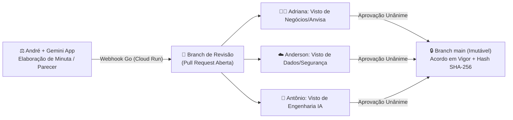

# ⚖️ Legal Governance as Code — Direito, Governança Familiar & Compliance de IA
**Líder Responsável:** 👤 **André — Diretor Jurídico, Governança & LegalOps (Direito)**

> [!IMPORTANT]
> **Missão do Repositório:** Substituir documentos estáticos e vulneráveis (Word/Google Docs/PDFs soltos) por **Contratos, Pareceres e Políticas como Código (*Legal as Code*)**, garantindo rastreabilidade criptográfica (`git blame`), revisão cláusula a cláusula via *Pull Request* e integração nativa com os motores de IA do **Antônio** e a auditoria de dados do **Anderson**.

---

## 🏛️ 1. Por Que Usamos Git e Markdown em vez de Word/Google Docs no Jurídico?

| Dimensão Jurídica | ❌ Modelo Tradicional (Word / Google Docs) | ✅ Modelo Fratuci Labs (*Legal as Code* no GitHub) |
| :--- | :--- | :--- |
| **Cadeia de Custódia & Autoria** | Histórico confuso; arquivos duplicados (`Contrato_vFinal_2_AGORA_VAI.docx`). | Cada alteração possui hash criptográfico **SHA-1/SHA-256**, timestamp imutável e autor identificado. |
| **Revisão Societária (Diff)** | "Controlar Alterações" poluído e difícil de auditar em múltiplos documentos. | **Pull Requests** mostram exatamente qual palavra ou parágrafo mudou (verde = inserido, vermelho = removido). |
| **Aprovação Multidisciplinar** | Aprovações perdidas em áudios de WhatsApp ou threads de e-mail. | Cláusulas técnicas e clínicas exigem *Review* formal de **Adriana**, **Anderson** e **Antônio** antes do *Merge*. |
| **Compatibilidade com IA (RAG)** | Arquivos binários `.docx` e `.pdf` quebram tabelas e perdem semântica no LLM. | **Markdown + Frontmatter YAML** é lido nativamente pelos agentes do **Antônio** com zero perda de estrutura. |
| **Automação Zero Barreira** | Copiar e colar manual propenso a erro humano. | O **André** conversa com o **Gemini App**, estrutura o parecer e publica direto no repositório via Webhook. |

---

## 📂 2. Estrutura do Repositório Jurídico

| Diretório / Arquivo | Descrição Executiva | Status |
| :--- | :--- | :---: |
| [`societario/protocolo-familiar-e-acordo-de-socios.md`](./societario/protocolo-familiar-e-acordo-de-socios.md) | **Protocolo Familiar & Acordo de Sócios:** Regras de governança, separação estrita entre **Pró-Labore** e **Distribuição de Lucros**, quóruns de deliberação e blindagem patrimonial LTDA. | Em Vigor (`v1.0.0`) |
| [`compliance-ia/matriz-risco-lgpd-e-ia.md`](./compliance-ia/matriz-risco-lgpd-e-ia.md) | **RIPD & Compliance de IA:** Relatório de Impacto à Proteção de Dados (LGPD Art. 20 e 38), Marco Legal da IA e limites de responsabilidade civil para agentes de saúde. | Em Vigor (`v1.0.0`) |
| [`legalops/politica-licencas-open-source.md`](./legalops/politica-licencas-open-source.md) | **Política de Licenças Open-Source:** Lista branca (`MIT`, `Apache-2.0`, `BSD`) e bloqueio estrito de licenças contaminantes (`AGPL-3.0`, `GPL`) nos projetos Go/Rust. | Em Vigor (`v1.0.0`) |
| [`historico-gemini/2026-10-parecer-automacao-contratual.md`](./historico-gemini/2026-10-parecer-automacao-contratual.md) | **Série Histórica Automatizada:** Parecer jurídico elaborado pelo André via conversa no Gemini App e ingerido automaticamente na base. | Auditado |

---

> [!TIP]
> **Cláusula de Ouro do LegalOps:**  
> *"Um contrato que não pode ser lido por humanos e auditado por máquinas simultaneamente já nasce obsoleto."*
